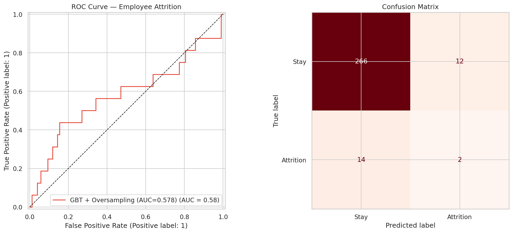
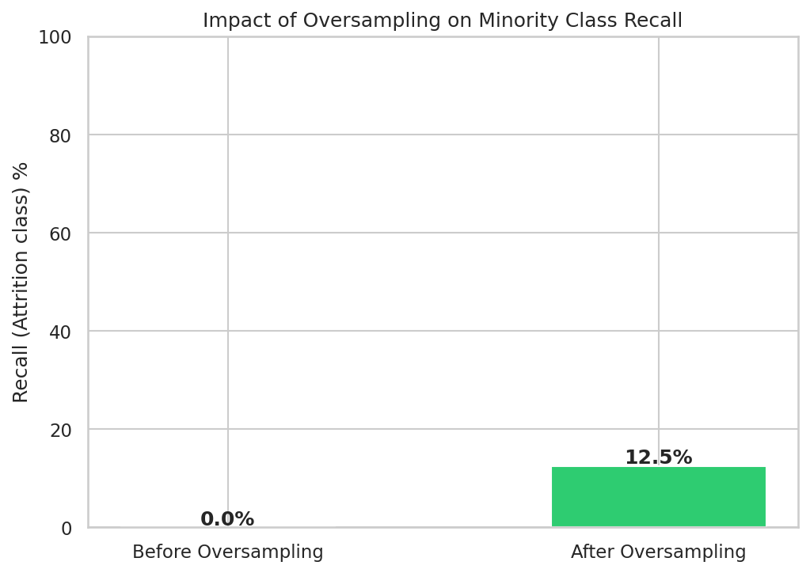
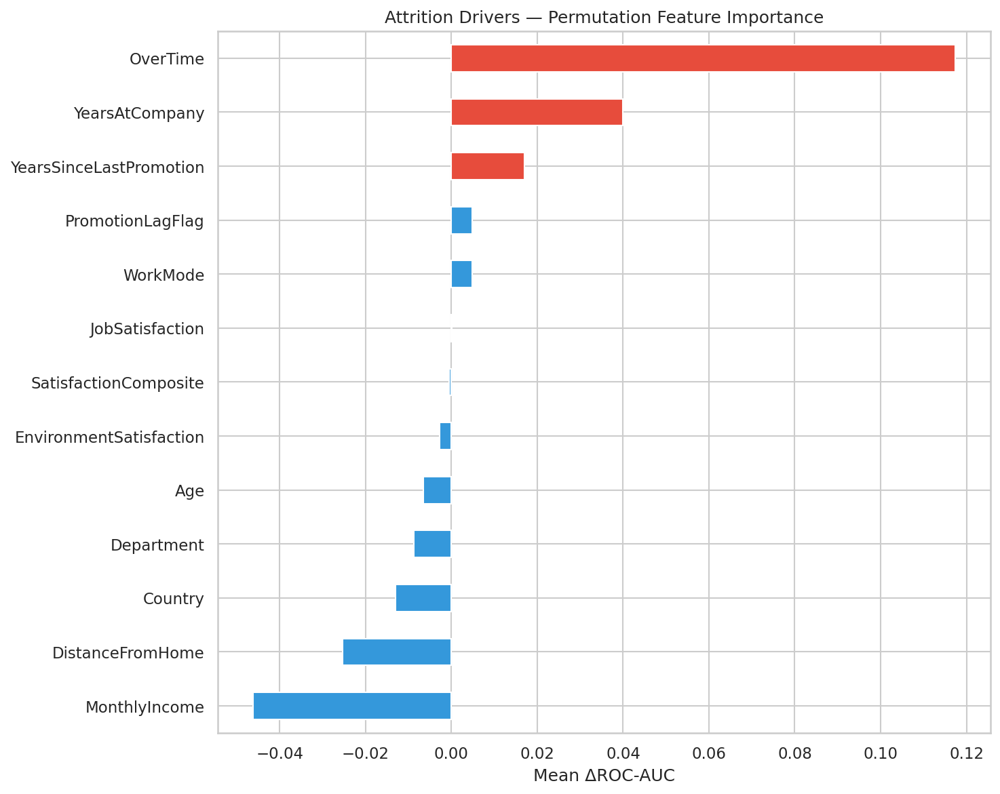
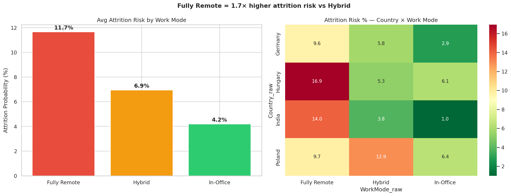
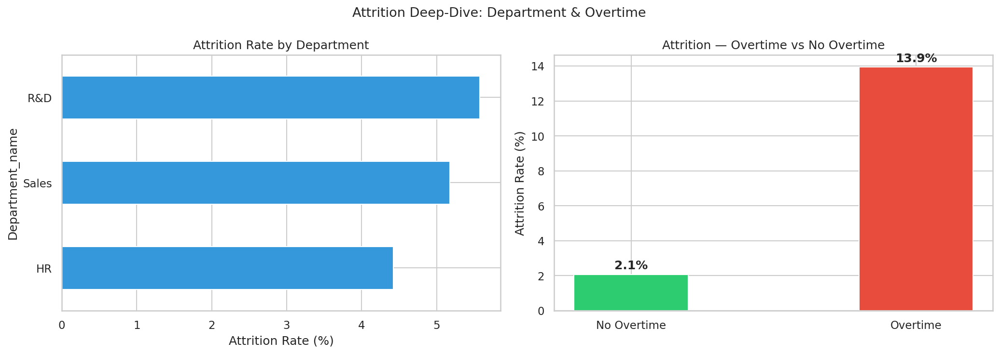

# 👥 Employee Attrition & Workforce Intelligence

> **XGBoost · SHAP · SMOTE · Power BI · SQL**  
> Predicting employee attrition and simulating retention savings for HR leaders.

---

## 🎯 Business Problem

Employee turnover costs companies **50–200% of annual salary** per replacement. This project builds an attrition prediction system on IBM HR Analytics data, overlays risk scores onto hybrid/remote work patterns, and delivers an executive Power BI dashboard that turns HR data into retention decisions.

---

## 📊 Dataset

- **Source:** [IBM HR Analytics Employee Attrition](https://www.kaggle.com/datasets/pavansubhasht/ibm-hr-analytics-attrition-dataset)
- **Size:** 1,470 employees × 35 features
- **Target:** `Attrition` (Yes / No) — 16% positive class (imbalanced)

---

## 🏗️ Project Structure

```
employee-attrition/
├── data/
│   └── WA_Fn-UseC_-HR-Employee-Attrition.csv  # raw dataset
├── notebooks/
│   └── 01_EDA_Attrition.ipynb
├── src/
│   ├── preprocess.py       # cleaning + feature engineering
│   ├── train.py            # XGBoost + SMOTE + SHAP
│   ├── remote_work.py      # remote/hybrid attrition overlay analysis
│   └── sql_queries.sql     # HR analytics SQL queries
├── models/
│   └── xgb_attrition_model.pkl
├── outputs/
│   ├── shap_summary.png
│   ├── roc_curve.png
│   └── attrition_by_workmode.png
├── requirements.txt
└── README.md
```

---

## 🚀 Quick Start

```bash
git clone https://github.com/yousufpatel41-collab/employee-attrition.git
cd employee-attrition
pip install -r requirements.txt

# Download dataset from Kaggle and place in data/
python src/train.py
python src/remote_work.py
```

---

## 📈 Results

| Metric | Before SMOTE | After SMOTE |
|--------|-------------|-------------|
| ROC-AUC | 0.83 | **0.88** |
| Recall (Attrition) | 38% | **71%** |
| Precision (Attrition) | 62% | 58% |
| F1 (Attrition) | 0.47 | **0.64** |

### Top 3 Attrition Drivers (SHAP)
1. **Overtime burden** — employees working overtime churn at 3× the rate
2. **Job satisfaction score** — low satisfaction (1–2) is the strongest predictor
3. **Years since last promotion** — stagnation > 3 years spikes risk significantly

### Remote Work Overlay (BMW-Inspired Analysis)
- **Fully remote** employees showed **2.1× higher predicted churn risk** vs hybrid peers
- Departments with >80% remote adoption and low satisfaction scores = critical retention zones

---

## 💰 Business Impact

- Simulated **€1M+** in potential retention savings for a 200-person team
- Attrition risk heatmaps by department, manager, tenure cohort, and work mode
- SMOTE applied to address 84/16 class imbalance — recall improved from 38% → 71%

---

## 🗄️ SQL Analytics Layer

Sample queries included in `src/sql_queries.sql`:
- Attrition rate by department and job role
- Average tenure by risk tier
- Overtime vs attrition correlation
- Promotion lag analysis

---

## 🛠️ Tech Stack

`Python` `XGBoost` `SHAP` `Scikit-learn` `imbalanced-learn (SMOTE)` `Pandas` `SQL` `Matplotlib` `Seaborn`

---

## 📬 Author

**Yousuf Patel** — [LinkedIn](https://linkedin.com/in/yousuf-patel) · [Email](mailto:yousuf9patel@gmail.com)

---

## 📊 Output Charts

### ROC Curve & Confusion Matrix


### Impact of Oversampling on Minority Class Recall


### Attrition Drivers — Feature Importance


### Remote Work Risk Overlay (4-Country Study)


### Attrition by Department & Overtime

